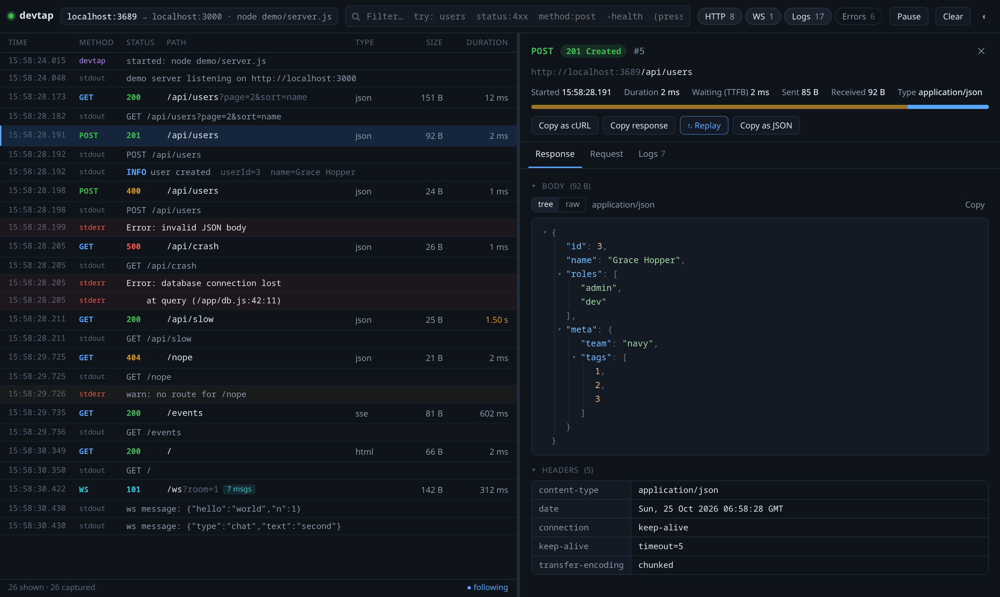
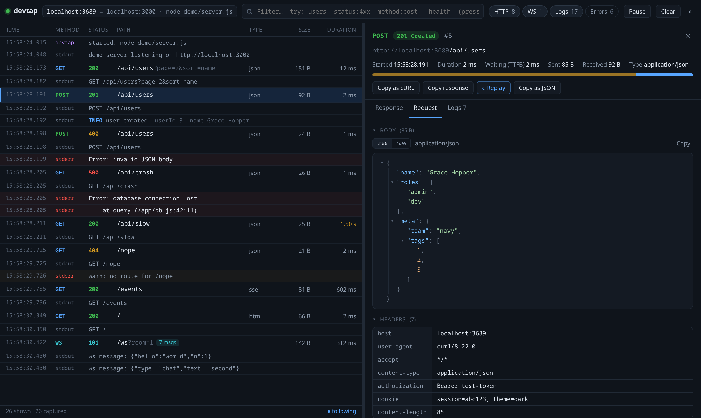
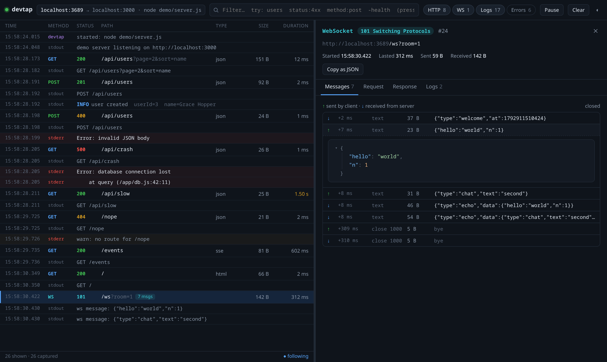

# devtap

See every request, response, WebSocket message and log line of your local server in one readable, live UI. No dependencies, just Node 18+.



```
 browser / curl / app  ──▶  devtap :3689  ──▶  your server :8080
                               │
                               └──▶  inspector UI :9090
```

## Install

```bash
npm install -g github:thalhath2234/devtap
```

Run the same command again to update. Needs Node 18 or newer.

From a clone of this repo, install your local copy with `npm pack && npm install -g ./devtap-*.tgz`, or run it without installing: `node devtap.js 8080`. To try it on a demo server: `npm run demo`, then `./demo/traffic.sh`.

## Connect

```bash
devtap                  # pick one of your running servers from a list
devtap 8080             # connect to a server that's already running
devtap ports            # list what's listening on this machine
```

Then send your requests to **http://localhost:3689** instead of your server's port, and open the inspector at **http://localhost:9090** (or add `-o` to open it for you). If 3689 or 9090 is taken, devtap uses the next free port and prints it.

### Keep your frontend's port

If you'd rather not point your frontend at a new port, let devtap take over the port your server normally uses:

```bash
devtap 8080 --swap -- go run .
```

devtap listens on 8080 and starts your server on the next free port (8081 if free), passing the port to it in `$PORT`. Your frontend keeps calling `localhost:8080`, and everything shows up in the inspector. Nothing must be running on 8080 when you start.

Your server has to read its port from the environment. In Go:

```go
port := os.Getenv("PORT")
if port == "" {
	port = "8080"
}
http.ListenAndServe(":"+port, handler)
```

If your server uses a different variable, name it with `--port-env`, e.g. `--port-env HTTP_PORT`. If the server ignores it and tries to take 8080 anyway, devtap tells you.

## Logs

When you connect to a running server, devtap looks for its logs automatically:

| Your server…                                  | devtap does                                   |
| --------------------------------------------- | --------------------------------------------- |
| writes to a file (`./server > app.log`)       | follows that file                             |
| runs as a systemd service                     | follows `journalctl` for that unit            |
| runs in a Docker container publishing the port | follows `docker logs`                        |
| prints to a terminal                          | tells you to use `--attach`, or to restart it through devtap |

To choose the log source yourself:

```bash
devtap 8080 -l /var/log/app.log          # a file (repeatable)
devtap 8080 --docker api                 # a container
devtap 8080 --journal myapp              # a systemd service
devtap 8080 --log-cmd "kubectl logs -f deploy/api"   # any command's output
docker compose logs -f api | devtap 8080 # anything piped in
devtap 8080 --attach                     # what a running server prints to its terminal
devtap 8080 -- go run .                  # start the server through devtap
```

`--attach` reads a running process's output without restarting it, by tracing its writes to stdout and stderr with `strace`. It needs `strace` installed (`sudo pacman -S strace` / `sudo apt install strace`). On most distros it also needs root, so devtap runs it through `sudo`, which may ask for your password. It only works on Linux, and it slows the traced process a little.

## What it shows

- **Every HTTP request**: method, URL, status, timing (wait vs download), sizes, headers, query params, cookies, request and response bodies.
- **Bodies decoded and pretty-printed**: gzip, br, deflate and zstd are decompressed. JSON shows as a collapsible tree, forms as tables, SSE and NDJSON as separate events, HTML and images as previews, binary as hex.
- **WebSockets**: every frame in both directions, with JSON payloads expandable.
- **Server logs**, interleaved with traffic in one timeline: ANSI colours are kept, JSON logs (slog, zap, zerolog, pino) are parsed, and errors and warnings are highlighted. Each request has a **Logs** tab with the lines printed while it was in flight.
- **Actions**: copy as cURL, copy the body, replay a request, or copy the whole exchange as JSON.

**Request details**: query parameters, body, headers and cookies.



**WebSockets**: each message with its direction and timing, and JSON payloads you can expand.



UI keys: `/` filter · `↑ ↓` / `j k` move · `Space` pause · `Esc` close or clear the filter.
Filter syntax: free text, `status:4xx`, `method:post`, `is:error`, `is:ws`, `is:log`, `is:pending`, `-healthcheck` (exclude).

## Notes

- devtap records traffic by sitting in the middle, so only requests sent to the devtap port are captured. Requests that go straight to your server's port aren't seen.
- Captured data lives in memory only (the last 5000 items, set with `--keep`). Bodies over 2 MB are truncated for display (set the limit with `--max-body <kb>`). Proxying itself is never truncated.
- The inspector binds to 127.0.0.1 only, because it shows auth headers and cookies.
- WebSocket compression (`permessage-deflate`) is turned off on proxied connections so that frames stay readable.
- To see calls your server makes **out** to other APIs, run a second devtap in front of that API, e.g. `devtap https://api.example.com -p 3690`, and use `http://localhost:3690` as its base URL in development.
